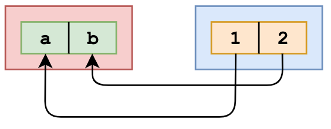
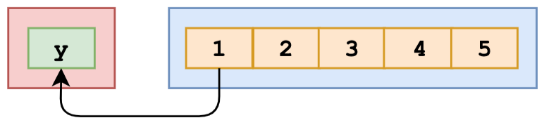

```javascript
const numbers = [1, 2, 3, 4, 5];
const [y] = numbers;

console.log(y);
```

## Explanation

We can unpack values from arrays or properties from objects through destructuring. For example:

```javascript
[a, b] = [1, 2];
```



The value of `a` is now `1`, and the value of `b` is now `2`. What we actually did in the question, is:

```javascript
[y] = [1, 2, 3, 4, 5];
```



This means that the value of `y` is equal to the first value in the array, which is the number `1`. When we log `y`, `1` is returned.
