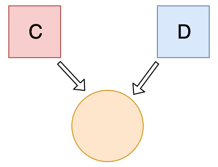

```javascript
let c = { greeting: 'Hey!' };
let d;

d = c;
c.greeting = 'Hello';
console.log(d.greeting);
```

## Explanation

In JavaScript, all objects interact by _reference_ when setting them equal to each other.

First, variable `c` holds a value to an object. Later, we assign `d` with the same reference that `c` has to the object.



When you change one object, you change all of them.
