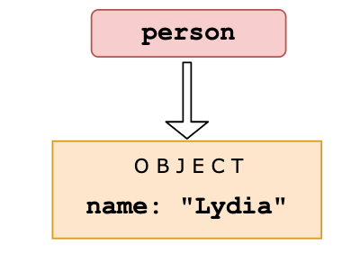
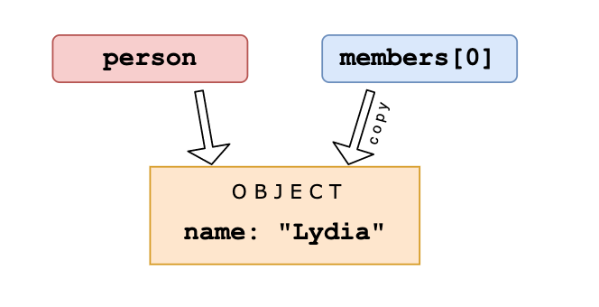
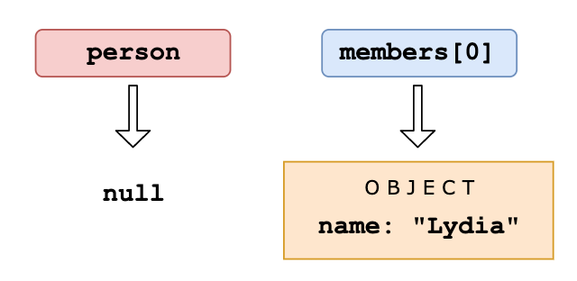

```javascript
let person = { name: 'Lydia' };
const members = [person];
person = null;

console.log(members);
```

## Explanation

First, we declare a variable `person` with the value of an object that has a `name` property.



Then, we declare a variable called `members`. We set the first element of that array equal to the value of the `person` variable. Objects interact by _reference_ when setting them equal to each other. When you assign a reference from one variable to another, you make a _copy_ of that reference. (note that they don't have the _same_ reference!)



Then, we set the variable `person` equal to `null`.



We are only modifying the value of the `person` variable, and not the first element in the array, since that element has a different (copied) reference to the object. The first element in `members` still holds its reference to the original object. When we log the `members` array, the first element still holds the value of the object, which gets logged.
