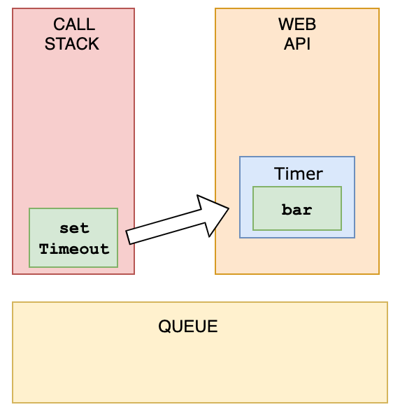
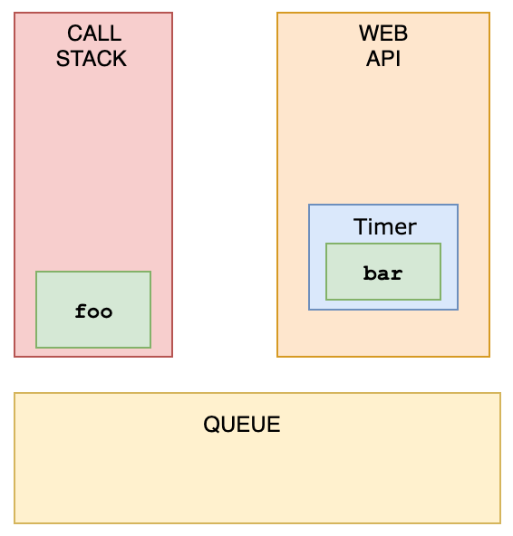
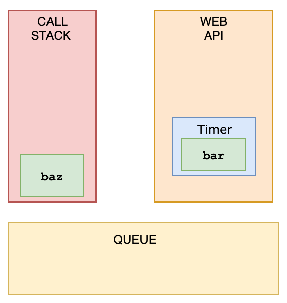
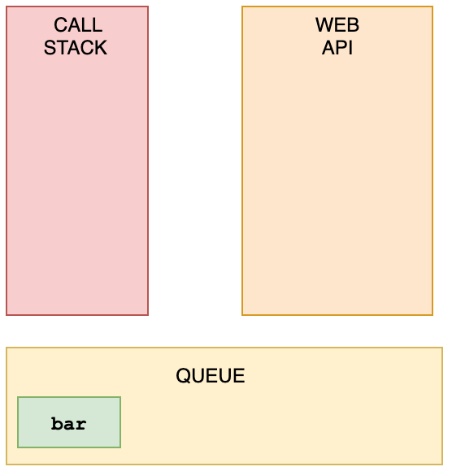
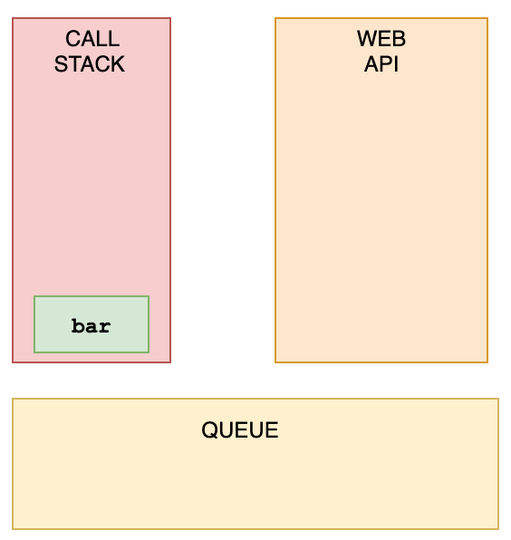

```javascript
const foo = () => console.log('First');
const bar = () => setTimeout(() => console.log('Second'));
const baz = () => console.log('Third');

bar();
foo();
baz();
```

## Explanation

We have a `setTimeout` function and invoked it first. Yet, it was logged last.

This is because in browsers, we don't just have the runtime engine, we also have something called a `WebAPI`. The `WebAPI` gives us the `setTimeout` function to start with, and for example the DOM.

After the _callback_ is pushed to the WebAPI, the `setTimeout` function itself (but not the callback!) is popped off the stack.



Now, `foo` gets invoked, and `"First"` is being logged.



`foo` is popped off the stack, and `baz` gets invoked. `"Third"` gets logged.



The WebAPI can't just add stuff to the stack whenever it's ready. Instead, it pushes the callback function to something called the _queue_.



This is where an event loop starts to work. An **event loop** looks at the stack and task queue. If the stack is empty, it takes the first thing on the queue and pushes it onto the stack.



`bar` gets invoked, `"Second"` gets logged, and it's popped off the stack.
